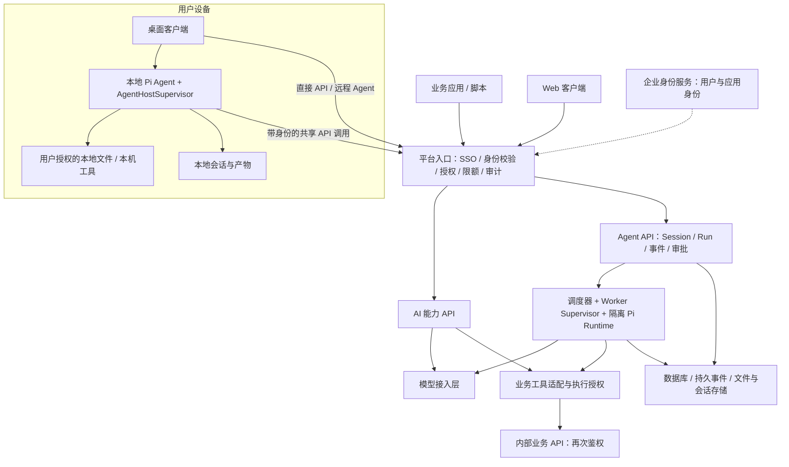

# 内部 AI 能力与本地 / 远程 Agent 平台演进路线

规划日期：2026-10-18。状态：根据用户手绘架构修订的建议基线，供立项、拆分需求和阶段验收使用；尚未实施。

## 1. 目标与规划前提

最终目标：建立一个内部可用的 Agent 平台，为内部用户及业务应用提供经过认证、鉴权、限额、审计的共享 API、本地 Agent 与远程 Agent 能力。桌面客户端内的本地 Agent 长期承担本地文件分析和本机工具执行；桌面 / Web 可使用服务端远程 Agent；业务应用也可直接使用能力 API。本地与远程 Agent 共用认证后的模型和业务 API，模型供应商凭据由平台管理。本地 Pi 可随客户端打包。

当前基线：Electron / React 界面，经 preload、主进程 IPC 连接 utilityProcess Agent Host；Pi SDK 在该进程中执行，保存本地 JSONL Session，已有工具审批和取消。当前 Host 保存一个全局活动 Session 和 cwd，凭据、会话和工具执行均以本地使用为前提，不具备生产多用户后端的完整边界。

本规划默认：内部使用；本地 Agent 使用本地工具与共享远程 API，远程 Agent 主要使用远程业务 API 及其隔离执行环境。优先复用已有身份系统和模型供应商 API，首轮限制在少量用户和有限并发。是否已有 SSO、哪些业务 API 可用、哪些本地文件内容允许发送给选定模型，需要在 P0 确认。

本地 Agent 是长期产品能力，按独立路线建设本地文件读取 / 分析、工具权限、会话恢复与 AgentHostSupervisor，并对接共享 API。本地执行与远程执行分配各自的会话、任务与状态；共用协议和可复用运行内核，不默认共用运行中的实例。完整后台守护、本地文件同步及远程驱动本机工具可在有明确需求时追加，不作为两条主线的必备能力。

## 2. 两类服务入口、本地 / 远程执行与三个调用层次

| 入口 | 使用者 | 典型调用 | 状态与责任 |
| --- | --- | --- | --- |
| AI 能力 API | 业务应用、脚本，也包括本地 Agent | 文本总结、结构化抽取、受控问答等命名能力 | 短调用可同步或流式；长调用创建可查询的任务。业务系统负责自己的业务流程 |
| 本地 Agent | 桌面客户端用户 | 分析选定目录 / 文件、使用本机工具，并调用共享模型 / 业务 API | 本地 Host 负责 Session / Run、本机权限、执行和恢复；服务端负责每次共享 API 调用的鉴权、限额和审计 |
| 远程 Agent | 桌面 / Web 用户；也可由业务应用调用任务 API | 创建会话、提交目标、多步工具调用、等待审批、查看结果 | 平台负责 Session / Run、事件、工具权限、取消、恢复与审计 |

服务提供方式分为共享 API 与远程 Agent 服务；本地 Agent 是桌面侧独立执行方式，并是共享 API 的调用者。桌面可以直接调用能力 API、使用本地 Agent 或连接远程 Agent。Web 使用能力 API 与远程 Agent，本规划不要求浏览器后台任意访问本机文件。远程 Agent 同样可通过 API 创建和管理任务。能力 API 不要求每次调用都创建 Pi Session；需要多步推理的命名能力也可以复用 Agent Runtime。

调用层次必须分清：

1. 模型接入层：统一供应商、模型配置、凭据、模型权限、限额、调用观测；Pi 使用适配器接入，先验证流式、取消、工具调用、错误和用量兼容性。
2. 能力层：版本化的输入 / 输出 schema、提示词、可调用模型 / 工具及评估用例，例如 summarize-v1、extract-v1。命名能力默认不能任意越权使用工具。
3. 业务工具层：检索知识、查询业务对象、执行内部操作等真实业务 API。能力服务、本地 Pi、远程 Pi 都可经适配调用，但每次调用均须鉴权。

不应仅因调用者是 Agent 而赋予更大权限。第一期不支持由模型生成任意 URL 并携带通用凭据访问业务系统；采用已登记工具、固定目标服务、参数 schema 和明确权限规则。

## 3. 目标架构

这是逻辑边界，不要求一开始拆成微服务。第一期可由一个后端代码库部署 API / 控制面，Pi Worker 单独运行；模型接入、策略和审计先作为清晰模块存在。保留后续分拆部署的能力。

本地 Pi 使用用户选择并授权的文件 / 目录；远程 Pi 使用服务器的独立运行目录或业务 API，不默认读取用户电脑。远程 Agent 如不使用文件工具，仍可提供最小运行目录以满足 Pi 配置与会话资源加载。服务器会话文件与必要产物持久保存，临时工作区可回收。

通信约定：HTTPS 管理能力请求、项目、历史和 Run；能力输出流可选 HTTP 流式 / SSE；WSS 用于远程 Agent 事件、审批和取消。创建长任务先持久接收，再返回 accepted / runId，执行结果通过查询及事件获取。

本地 / 远程边界：

- 本地 Agent 自己执行本地工具；平台入口接收它发出的模型、能力或业务 API 请求，并不要求每次本地分析都创建服务端远程 Run。
- 本地文件读取与远程模型推理是两件事。文件可以在本机筛选 / 解析，但送入远程模型的文本仍离开设备；需定义发送范围、必要内容、敏感数据处理和用户可见说明。
- 本地文件、原始会话和产物默认由本地模式保存；远程会话和产物由服务器保存。共享 API 的审计和用量记录保存在平台；是否保存请求正文由独立数据策略决定。云同步须另行设计。
- 远程 Agent 直接访问本机需要额外的设备绑定和受限执行通道，不是当前两种模式自然具备的能力。
- AgentHostSupervisor 与 WorkerSupervisor 可复用监督状态机，通过本地进程 / 服务端沙箱适配各自执行环境。Pi Runtime 的可复用模块不会取消它们各自的权限、生命周期和存储边界。

## 4. 身份与授权边界

| 场景 | 身份方式 | 授权主体与约束 |
| --- | --- | --- |
| 人使用桌面 / Web | 复用企业 SSO / OIDC；桌面使用系统浏览器和 PKCE | 已验证用户及其组织 / 项目成员关系 |
| 应用以自身身份调用 | 机密服务端应用可使用 client credentials 或现有工作负载身份 | 服务账号自身权限；不能默认访问某个人的数据 |
| 应用 / Agent 代表用户调用 | 受控的委托机制；可使用企业 IdP 支持的 token exchange / on-behalf-of | 同时保留用户与调用应用身份，权限不能超出有效委托范围 |
| 本地 Pi 调用共享 API | 用户登录或受限的应用身份，按调用用途选择 | 桌面属于 public client，不能内置可保密的通用 client_secret |

网关验证 access token 的签发者、目标服务、期限及有效状态；从已验证身份与服务端成员关系确定组织和权限，不能信任请求体传入的 userId / tenantId。

平台入口检查资源访问；工具执行层检查当前 Run、工具、参数和授权范围；最终业务 API 按其资源规则再次鉴权。审批是额外条件，不能授予用户本来没有的权限。内部网络不替代身份和权限检查。

登录 Token、业务 API Token、模型供应商 API Key 为不同用途的凭据，不应互相通用。跨服务令牌按 audience 和 scope 限定；不把原始 SSO Token 不加区分地转交所有工具。没有委托能力时，先开放服务账号权限内、明确标记为应用调用的能力，或限制用户场景，不能伪造用户身份冒充委托。

Token exchange 只是可选的委托协议，需身份服务与业务 API 配合；不作为所有系统已有的能力假设。长任务还要定义授权到期后的暂停、重新授权、撤销和执行前权限复查。

## 5. 阶段路线与验收门槛

按阶段验收推进，保留两条执行主线：本地 Agent 稳定性与文件能力；远程 Agent 服务化与多用户能力。共享 API、认证和工具契约为两条主线提供共同基础。P0 / P1 可在远程 Runtime 之前交付本地使用价值与 API 能力。

### P0：收敛业务目标与契约

工作：
- 选两个命名 AI 能力、一项本地文件分析和一项远程 Agent 场景。候选为文档总结、结构化抽取、本地目录报告分析、受控知识查询 Agent；以真实业务需求确定最终名单。
- 优先选择只读或低影响的业务 API，登记调用者、数据来源、权限、输出及成功标准。
- 定义 User / ServicePrincipal、组织 / 项目成员关系、Capability、Session、Run、Tool、Approval 及用量记录。
- 定义命令 / 事件契约及稳定标识：requestId、sessionId、runId、toolCallId、事件 seq、协议版本；明确 accepted 与 completed 的差别。
- 明确本地 / 服务端状态归属、Pi 会话文件持久化方案、恢复与迁移边界。

产物：最小范围说明、目标架构、接口草案、权限矩阵、资源清单、评估用例与试用者名单。

验收：每个试点场景能回答“谁调用、读哪些数据、允许哪些动作、如何判断结果正确”；实现团队可据此拆开发任务。未明确授权的数据源和工具不进入首轮。

### P1：带认证鉴权的 AI 能力 API

工作：
- 建立独立于 Electron 的后端服务，接入现有 SSO / IdP，支持所需用户身份及服务端应用身份。
- 实现两项命名能力、模型适配、版本化输入输出、流式 / 取消、超时、限额和用量记录。
- 接通首个受控业务 API；同时实现入口与资源鉴权，测试越权调用。
- 建立工具 registry 和服务端授权上下文；将本地 Pi 的模型 / 业务调用接入共享 API，并保留本地文件工具的独立权限检查。
- 凭据只在受控服务端保存；日志做必要脱敏，记录请求关联信息与错误归因。
- 本地 Agent 完成 Supervisor、运行状态一致性、文件范围授权、取消和会话恢复；以真实本地文件分析场景验收。补足本地内容发送到远程模型的范围说明与控制。

产物：可部署 API 服务、接口文档、认证接入说明、调用示例、用量与错误可见的基础后台，以及可稳定分析本地文件并调用共享 API 的桌面 Agent。

验收：一个独立业务程序能完成“获取凭证 → 调用能力 → 取得结果”；本地 Agent 能在授权范围内读取文件、经共享模型 API 分析并给出结果。非法身份、超权限资源、超额请求均被拒绝；本地 Pi 与业务程序调用共享 API 时遵循同一服务端授权规则。本地 Agent 崩溃和 API 故障分别显示，不能把本地读取等同于内容从不出设备。

阶段结束即可提供 AI 能力，不必等待完整远程 Agent。

### P2：远程 Agent 纵向闭环

工作：
- 从 electron/agent-host.mjs 抽出可在普通 Node 服务端运行的 Pi Runtime / AgentService，Electron MessagePort 作为一个适配器保留。
- 实现 Agent API、Session / Run 状态机、持久接收、事件记录与 WSS 订阅。
- 按活跃 Session 分配隔离执行实例，配置独立 Pi 目录与工具白名单；接入 P1 的模型与业务工具接口。
- 客户端增加 RemoteTransport 和远程项目 / 会话数据来源；本地模式继续提供本地 cwd、文件选择与预览，远程模式独立运行且不依赖这些本机资源。明确展示执行位置并将会话绑定到执行位置，模式切换不静默迁移任务或文件。
- 实现 WorkerSupervisor、启动 / 存活 / 就绪判断、取消和进程树清理；崩溃恢复会话历史、标记中断，不自动重放未知结果的写操作。
- 支持带授权上下文的审批，审批到期拒绝或暂停；定义用户离线和 Token 过期的任务政策。

产物：一个试点用户可通过界面完成远程多步任务；也可通过 Agent API 完成同一任务。

验收：从登录到创建 Session、提交任务、调用至少一个真实业务工具、流式返回、查询历史、取消形成闭环；关闭客户端后任务按既定政策运行，重连可恢复状态。即使只有一位试点用户，也不得开放无认证的 Runtime 入口。

### P3：多用户试用与恢复完整性

工作：
- 将平台权限覆盖到 Session、Run、产物、事件订阅、工具调用和审批；加入两个用户的交叉访问负向测试。
- 完成会话单写者、持久幂等记录、每会话单调事件序号、重连补发及保留期之外的快照恢复。
- 调度器支持有界队列和用户 / 应用 / 项目配额。执行实例租约到期后，旧实例不得继续提交写入；需要执行器和状态存储配合 fencing 校验。
- 对 Pi 配置、会话、业务凭据、工作目录实施隔离；有 bash / 扩展执行时使用符合威胁模型的执行沙箱。
- 审计完整记录发起用户、调用应用、Session、Run、工具、授权结果、审批者和结果；密钥不进入事件和模型上下文。
- 用户与共享数据权限按成员关系建模，不能依靠路径前缀或“知道 Session ID”获得访问。

产物：内部测试环境、权限测试报告、并发和故障测试报告、运营查看入口。

验收：建议先 3–5 位用户 / 2 个并发，再验证 10–20 位用户 / 5 个并发；这些是初始测试目标，非容量承诺。用户 A 无法读取或操作 B 的受限资源，重试不重复创建 Run，断线不丢终态，Worker 故障不会被误报为成功，费用和用量能够归属到调用者。

### P4：内部正式运行

工作：
- 准备测试 / 生产环境、发布回滚、迁移、依赖与 Pi 版本锁定、模型 / 提示词 / 工具版本管理。
- 完成数据库与会话 / 产物存储备份和恢复演练、密钥轮换、身份撤销及业务 API 降级策略。
- 观测任务排队、首事件延迟、任务成功率、工具错误、Worker 重启、资源使用及调用成本；设置实际可响应的告警。
- 每次版本更新运行真实业务评估集；高影响写入工具逐个验收后开放。
- 指定平台负责人、业务工具负责人、身份与权限负责人及故障处理人，形成运行手册。

产物：正式访问入口、使用说明、运维手册、恢复与权限验收记录。

验收：建议试用至少两周并覆盖业务高峰；按试点数据确定可用性、响应和成本目标。一次完整恢复演练成功，关键故障有责任人，所有高优先级越权与数据串用问题关闭，再扩大开放范围。

## 6. 资源准备与责任

| 资源 | 最晚准备时间 | 需要落实的内容 |
| --- | --- | --- |
| 业务场景与负责人 | P0 | 两个 API 能力、一项本地文件分析、一项远程 Agent 任务、真实输入样本、正确结果与试点用户 |
| 身份系统与权限负责人 | P0–P1 | SSO / OIDC 接入、用户与组织关系、应用身份、业务接口是否支持用户委托 |
| 模型访问 | P1 | 一个主模型的服务端凭据、网络出口、可用额度、允许处理的数据范围与成本上限 |
| 业务 API 与工具负责人 | P1 | 文档、测试账号 / 环境、权限矩阵、错误码、限流、写接口幂等和超时结果查询 |
| 服务端环境 | P1 | 内部 DNS / TLS、API 计算资源、受控网络访问、测试与生产发布权限 |
| 持久化 | P1–P2 | 关系数据库；P2 起保存 Pi 会话与产物的卷或对象存储；恢复方案 |
| 本地执行与文件资源 | P0–P1 | 样本文件、允许读取的范围、内容远程发送规则、桌面打包与权限、Supervisor 故障验收 |
| 远程执行资源 | P2 | Worker 的隔离环境、进程树清理、CPU / 内存 / 磁盘 / 并发限制 |
| 观测与备份 | P1 起步，P4 完整 | 关联日志、审计、用量、指标、告警、数据保留和备份恢复 |
| 人员协作 | P0 起 | 至少明确后端 / 平台、客户端、身份 / 运维、业务接口四类职责；可由同一人兼任部分工作 |

模型使用外部或内部现有 API 时，不需要为了这条路线先购置 GPU。初始使用一个后端部署和独立 Worker 执行环境即可；数据库可复用已有托管设施。CPU / 内存和 Worker 数量以首个 Agent 的实际工具负载压测确定，用户总数不能直接换算成执行并发。

Redis / 消息中间件、多个控制面副本、Kubernetes、独立模型网关产品都不是第一期必需项。只有在多实例事件分发、排队可靠性、容量或部署管理出现明确需求时再引入；持久任务状态和事件记录从 P2 开始即需具备。

## 7. 契约和数据边界需提前固定

- API 外部契约不暴露 Pi 私有 Session 路径、SDK 原始对象、任意本机 cwd 或工具实现细节。本地模式通过本机 IPC 使用已授权资源，远程模式只接受远程资源标识。
- 控制数据库负责平台身份、项目关系、Run 生命周期、授权 / 审批 / 幂等和事件游标；Pi JSONL 负责其对话 / 工具历史，两者用稳定 sessionId 关联。
- 接收任务与向 Worker 投递使用可恢复的持久状态；先落接收记录再确认。重复投递需幂等处理；不能宣称任意工具有 exactly-once 保证。
- 对外事件必须先具备可恢复依据再依赖其驱动客户端终态；事件日志与 Pi JSONL 需定义一致性与异常核对流程，避免两个互相矛盾的“真相”。
- 模型 adapter 在 P1 / P2 验证 Pi 的流式、取消、工具调用、错误传播与计量；不假定所有“兼容接口”在上述行为上等价。
- 身份、模型凭据、执行就绪、网络连接为独立状态。当前 authenticated 不能继续同时表示模型配置与用户登录。
- 本地审批开关不能直接成为远程全局权限；平台授权始终由服务端执行，用户确认不能提升原有权限。

## 8. 实施优先级与下一批工作

共同基础：P0 业务与权限契约 → P1 认证能力 API。

本地执行主线：本地文件与工具权限 + AgentHostSupervisor → 对接共享 API → 文件分析验收 → 本地能力、分发和恢复持续迭代。

远程执行主线：Pi Runtime 服务化 → P2 远程单场景闭环 → P3 多用户隔离与恢复 → P4 内部运行。

本地 Agent 与远程 Agent 持续并存。共享 API 演进服务于两条主线，远程上线不替代本地执行。

第一批可直接拆成以下工作项：
1. 从业务上确定两个能力 API、一项本地文件分析与一个只读远程 Agent 场景，登记本地工具范围和首个业务工具。
2. 检查企业 SSO、模型访问、业务 API 用户 / 应用身份能力，形成权限矩阵。
3. 起草 Capability API 与 Agent Session / Run / Event 契约及授权上下文，明确状态和存储归属。
4. 建立独立后端骨架，实现带身份与资源授权的一项能力 API。
5. 完成流式 / 取消 / 错误 / 用量和越权验收，再扩展第二项能力；为 Pi 模型 / 工具适配留下接口。
6. 并行补齐本地 Supervisor、文件范围与远程内容发送控制；以同一共享 API 完成本地文件分析验收，再启动 Pi Runtime 服务端抽离与 RemoteTransport。

排期应在 P0 的场景和身份 / API 资源盘点后估算，以工作包和验收门槛作为当前的明确承诺。业务接口改造、身份委托能力和真实评估结果往往比 UI 页面数量更影响进度。

## 9. 协议依据

- OAuth 安全最佳实践 RFC 9700：https://www.rfc-editor.org/rfc/rfc9700.html 。涉及 access token 的目标服务与权限范围限制。
- 原生应用 OAuth RFC 8252：https://www.rfc-editor.org/rfc/rfc8252.html 。涉及系统浏览器、PKCE 与桌面 public client。
- OAuth Token Exchange RFC 8693：https://www.rfc-editor.org/rfc/rfc8693.html 。委托能力的可选标准，需身份服务和目标资源服务支持。

以上阶段、资源安排、测试规模与验收项为针对当前原型的规划建议，不是上述协议规定的产品实施路线。
